<div align="center">



[](https://optiq-ai.com/)
[](#public-builds)
[](https://github.com/Apurvsheldiya25)



</div>

I build AI-native products that move from an idea to a usable result: intelligent prompting, visual workspaces, secure developer workflows, precise editing, and polished product experiences.


<h2 id="flagship"></h2>

### [OptiqAI](https://optiq-ai.com/) - AI Visual Content Studio

OptiqAI turns creative ideas into finished visual assets: generate images, refine them with focused edits, and export content without jumping between disconnected tools.

| Level | What the experience enables |
| --- | --- |
| **1 - Describe** | Natural-language creative direction for social posts, campaigns, carousels and visual concepts. |
| **2 - Generate** | AI-assisted generation with model choice and visible creative iteration. |
| **3 - Refine** | Targeted text edits, element edits, magic editing and guided prompt refinement. |
| **4 - Export** | Ready-to-use visual assets for content and marketing workflows. |

```text
Creative intent -> AI-assisted direction -> Canvas refinement -> Export-ready asset
```

[Play the live product](https://optiq-ai.com/) | [Pricing and workflows](https://optiq-ai.com/pricing)


<h2 id="what-i-build"></h2>

| World | What I build |
| --- | --- |
| AI creative production | Prompt-to-asset experiences, precision editing, guided refinement and export flows. |
| Desktop apps | Cross-platform Electron apps with staged rollouts, auto-update feeds and signed releases. |
| Visual workspaces | Canvas editors, panels, layers, tools, history and interaction-heavy UX. |
| Developer tooling | Terminal AI agents, secure CLI auth, CI release workflows and repo automation. |
| Intelligent interaction | Chat, voice, workflow orchestration and assistant-led experiences. |
| Architecture tooling | Cloud diagram editors and AI-supported multi-cloud planning. |

> AI should speed up decisions while the user stays in control of the final output.


<h2 id="public-builds"></h2>

| Build | What it shows | Stack |
| --- | --- | --- |
| [**Arch AI Blueprint Forge**](https://github.com/Apurvsheldiya25/arch-ai-blueprint-forge-42) | Interactive multi-cloud diagram editor: React Flow canvas, AWS/Azure/GCP palette, templates, AI analysis UI. | React, TypeScript, Vite, Tailwind, shadcn/ui, React Flow |
| [**Cloud Architect AI Flow**](https://github.com/Apurvsheldiya25/cloud-architect-ai-flow) | Product site for an AI cloud-architecture platform: landing, pricing, roadmap and auth journeys. | React, TypeScript, Vite, Tailwind, Framer Motion |
| **Clebby Code** *(private beta)* | Terminal-first AI dev companion: Supabase auth, workspace-aware Ask/Agent/Plan modes, hardened npm releases. | TypeScript, Bun, Supabase, OpenRouter, GitHub Actions |

Every public repo ships with no committed secrets, `.env.example` placeholders, a security policy, CI checks and Dependabot.


<h2 id="loadout"></h2>

<p align="center">
  
</p>

<h2 id="high-scores"></h2>

<p align="center">
  
  
</p>

<p align="center">
  <picture>
    <source media="(prefers-color-scheme: dark)" srcset="https://raw.githubusercontent.com/Apurvsheldiya25/Apurvsheldiya25/output/pixel-snake-dark.svg"/>
    
  </picture>
</p>

<p align="center">
  <a href="https://github.com/Apurvsheldiya25?achievement=quickdraw&tab=achievements"></a>
</p>

<div align="center">



[OptiqAI](https://optiq-ai.com/) | [Arch AI Blueprint Forge](https://github.com/Apurvsheldiya25/arch-ai-blueprint-forge-42) | [Cloud Architect AI Flow](https://github.com/Apurvsheldiya25/cloud-architect-ai-flow)

</div>
