<p align="center">
  <a href="https://github.com/Apurvsheldiya25">
    
  </a>
</p>

<p align="center">
  <a href="https://optiq-ai.com/"></a>
  <a href="https://optiq-ai.com/pricing"></a>
  <a href="#-public-builds"></a>
  
</p>


<table>
<tr>
<td width="56%" valign="top">

### 👾 About me

```ts
const apurv = {
  role:      "Founder @ OptiqAI",
  building:  ["OptiqAI", "Superclip", "Clebby Code"],
  loves:     ["AI UX", "visual editors", "pixel-perfect UI"],
  stack:     ["TypeScript", "React", "Electron", "Supabase"],
  shipping:  "every week",
  motto:     "AI speeds you up - you stay in control.",
};
```

- 🎨 Building **[OptiqAI](https://optiq-ai.com/)**, an AI visual content studio: describe → generate → refine → export
- 🖥️ Shipping cross-platform **desktop apps** with staged rollouts and auto-updates
- ⌨️ Making **developer tools**: terminal AI agents, secure CLI auth, release automation
- 🧭 Designing **visual workspaces**: canvases, layers, history, tool-driven creation

</td>
<td width="44%" align="center" valign="middle">

</td>
</tr>
</table>

## 🕹️ Flagship quest - [OptiqAI](https://optiq-ai.com/)

<table>
<tr>
<td align="center" width="25%"><b>01 · DESCRIBE</b><br/><sub>Natural-language creative direction for posts, campaigns &amp; carousels</sub></td>
<td align="center" width="25%"><b>02 · GENERATE</b><br/><sub>AI generation with model choice and visible iteration</sub></td>
<td align="center" width="25%"><b>03 · REFINE</b><br/><sub>Text edits, element edits, magic editing, guided prompts</sub></td>
<td align="center" width="25%"><b>04 · EXPORT</b><br/><sub>Ready-to-use assets for content &amp; marketing</sub></td>
</tr>
</table>

## 🧰 Loadout

<p align="center">
  <br/>
  
</p>

## 🏗️ Public builds

<table>
<tr>
<td width="33%" valign="top">

**[Arch AI Blueprint Forge](https://github.com/Apurvsheldiya25/arch-ai-blueprint-forge-42)**<br/>
<sub>Multi-cloud diagram editor - React Flow canvas, AWS/Azure/GCP palette, templates, AI review.</sub><br/><br/>
 

</td>
<td width="33%" valign="top">

**[Cloud Architect AI Flow](https://github.com/Apurvsheldiya25/cloud-architect-ai-flow)**<br/>
<sub>Product site for an AI cloud-architecture platform - landing, pricing, roadmap, auth journeys.</sub><br/><br/>
 

</td>
<td width="33%" valign="top">

**Clebby Code** <sub>· private beta</sub><br/>
<sub>Terminal-first AI dev companion - Ask / Agent / Plan modes, Supabase auth, hardened npm releases.</sub><br/><br/>
 

</td>
</tr>
</table>

## 🏆 High scores

<p align="center">
  
  
</p>

<p align="center">
  
</p>


<p align="center">
  
</p>

<p align="center">
  <picture>
    <source media="(prefers-color-scheme: dark)" srcset="https://raw.githubusercontent.com/Apurvsheldiya25/Apurvsheldiya25/output/pixel-snake-dark.svg"/>
    
  </picture>
</p>

<p align="center">
  <a href="https://github.com/Apurvsheldiya25?achievement=quickdraw&tab=achievements"></a>
</p>


